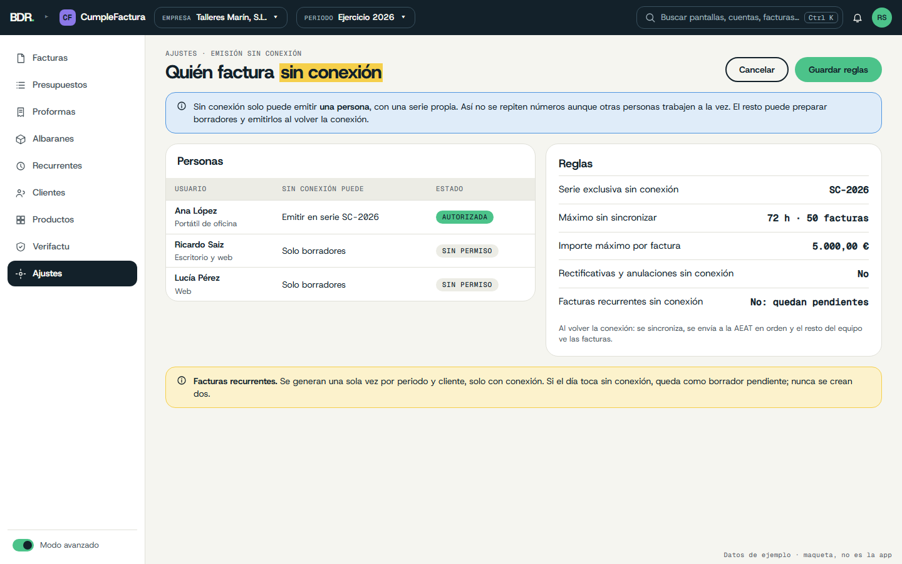

# UX/UI — CumpleFactura (rediseño)

Propuesta v2 · octubre 2026 · sigue la Guía de marca BDR v1.0 y es coherente con Empéñate, DocGen y Alquílame.
Maquetas: `docs/mockups/` (HTML + PNG a 1440×900). Plan de trabajo: `docs/IMPLEMENTACION_UX_UI.md`.

## Idea guía

> Emites una factura, se envía sola a la AEAT y ves en qué punto está. Con o sin conexión.

Usuarios: autónomos y pymes que facturan a diario y quieren cumplir sin estudiar normativa. Escritorio (Tauri 2, local-first) y versión web (Vercel + Supabase) con las mismas pantallas.

## Principios

1. **Envío desde el primer día.** Modo VERI*FACTU por defecto: al emitir se crea el registro de alta y se envía a la AEAT con el certificado de la empresa o de su representante.
2. **Con o sin conexión.** Sin conexión se sigue facturando: el registro queda en cola, marcado como incidencia, y se reenvía solo al volver la conexión (criterio de la FAQ de la AEAT: las incidencias no obligan a interrumpir la facturación).
3. **Estado fiscal honesto.** Cuatro pasos: Emitida → Registro de alta → Enviada → Respuesta de la AEAT (Aceptada · Aceptada con errores · Rechazada). Un paso solo se rellena si el sistema lo ha confirmado.
4. **Firma solo cuando toca.** En modo VERI*FACTU los registros no necesitan firma electrónica. Si una empresa usa el modo NO VERI*FACTU, los pasos pasan a: Emitida → Registro → Firmado → Conservado (sin envío).
5. **Numeración solo al emitir.** El borrador dice «Se numerará 2026-0128 al emitir»; el número real lo asigna Rust (como hoy).
6. **Lo irreversible se explica.** Emitir abre una confirmación con lo que ocurre y «Lo entiendo».
7. **Pantalla partida y teclado primero.** Formulario a la izquierda, vista previa (con QR VERI*FACTU) a la derecha.
8. **Proponer, no decidir.** En rectificativas la app propone causa R1–R5 y método, y lo dice: «La causa jurídica la decides tú».

## Marca aplicada

| Elemento | Uso |
|---|---|
| **Violeta** | Color de producto: icono «CF» en la barra superior, tarjeta en la web y selector de apps. No en botones ni estados |
| Pizarra | Barra superior, ítem activo, botón oscuro |
| Papel | Fondo; zona de vista previa en `#E6E6DF` (mismo gris cálido que DocGen) |
| Menta | «Nueva factura», «Emitir», Emitida, Aceptada |
| Sol | Palabra clave del título (una por pantalla); en cola, aceptada con errores, rectificativa |
| Cielo / Coral | Pendiente / rechazada, error, vencido (pequeño) |
| Geist Mono | Números de factura, NIF, importes, huellas, CSV, fechas |

Hoy: verdes `#1d5f4a`, Inter, solo modo claro → Menta + Pizarra, Host Grotesk + Geist Mono. Tema: sigue al sistema y se puede fijar en Ajustes (Claro · Oscuro · Sistema). Tokens en `docs/mockups/_assets/app.css`.

**Densidad** (cuántas filas caben en pantalla): cómoda por defecto (filas de 48 px, unas 12 visibles); el usuario puede pasar a compacta (40 px, unas 15) en Ajustes.

## Arquitectura de información

Barra lateral: **Facturas · Presupuestos · Proformas · Albaranes · Recurrentes · Clientes · Productos · Verifactu · Ajustes**. «Nueva factura» pasa a botón en la cabecera (`N`). Barra superior común de la suite (empresa y periodo siempre visibles); indicador de conexión con la AEAT y registros en cola.

Documentos comerciales y su flujo: **Presupuesto → Proforma → Albarán → Factura** (cada paso se crea desde el anterior con un clic, conservando líneas y enlace). Solo la factura genera registro VERI*FACTU; presupuestos, proformas y albaranes llevan series propias sin valor fiscal y lo dicen en el PDF. Varios albaranes del mes pueden agruparse en una factura recapitulativa. **Nota de crédito** = factura rectificativa (por ejemplo, un abono por diferencias negativas); en la interfaz se llama «Rectificativa (abono)» para no confundir.
- Primer arranque: asistente de 4 pasos (empresa, fiscalidad, primera serie, certificado y carpeta de exportación).
- Ventana mínima 1024×700; el menú se pliega por debajo de 1200 px; diálogos nativos para abrir/guardar.

## Pantallas clave

### 1. Facturas

Buscador (`/`), filtros (serie, estado, envío AEAT), tabla con estado de negocio y **línea de cuatro pasos Verifactu** con texto; chip «Sin conexión · 1 en cola» en la cabecera; totales al pie.

### 2. Editor de factura

Cliente, serie, fecha; líneas con cantidad, precio, IVA, IRPF; totales en mono; vista previa del PDF con el hueco del QR.

### 3. Confirmación de emisión

«Emitir factura 2026-0128»: número y QR, huella y registro encadenado, **envío a la AEAT con el certificado de la empresa (si no hay conexión, queda en cola)**, ya no se podrá editar.

### 4. Verifactu
 
Aviso de conexión, pasos de una factura con su CSV de respuesta, cadena de registros con estado de envío e integridad, conexión y certificado (caducidad, entorno pruebas/producción). SII, TicketBAI y FACe: «No disponible todavía».

### 5. Emisión sin conexión

Ajustes › Emisión sin conexión: una sola persona autorizada a emitir sin conexión, con serie exclusiva y límites (horas y facturas sin sincronizar, importe máximo); sin rectificativas ni anulaciones sin conexión; recurrentes nunca sin conexión.

### 6. Rectificativa (sin maqueta)
Asistente: qué ha pasado → propuesta de causa R1–R5 y método (sustitución o diferencias) como **sugerencia** → vista previa → confirmación.

## Microcopy

| Situación | Sí | No |
|---|---|---|
| Vacío | «Aún no hay facturas. Crea la primera.» | «¡Esto está muy vacío!» |
| Emitir | «Emitir factura 2026-0128. Después no se podrá editar; solo rectificar.» | «¿Seguro?» |
| Sin conexión | «Sin conexión con la AEAT. Puedes seguir facturando; lo enviamos al volver la conexión.» | «Error de red.» |
| Respuesta | «Aceptada por la AEAT · CSV A7Q2…9KD1» | «OK» |
| Con errores | «Aceptada con errores. Revisa el campo Destinatario.» | «Advertencia.» |
| Límite | «Comprueba con tu asesor que tu caso cumple lo que exige la normativa.» | «Cumple la ley al 100 %.» |

Tuteo; sin humor en importes, plazos ni avisos. Nunca «homologado» ni «la ley ya está cubierta».

## Accesibilidad

WCAG 2.2 AA claro y oscuro; los pasos Verifactu llevan texto además de punto de color; foco 2 px; zona táctil ≥ 44 px; `Esc` cierra diálogos; formato `es-ES`.

## Decisiones (2026-10-26, respuestas de Ricardo)

- **Firma y envío desde el primer momento** (modo VERI*FACTU por defecto; NO VERI*FACTU con firma como opción).
- **Online y offline**: escritorio funciona sin conexión con cola de envío; la web tolera caídas de la AEAT y cortes breves (reglas abajo, en la segunda ronda).
- Tema según el sistema, con ajuste del usuario. Densidad ajustable.
- Marca BDR con Violeta; estado fiscal de cuatro pasos siempre visible.
- Stack: se mantiene Vite + React (corre igual en Tauri y en la web); se comparte la capa de UI con ContaPro y la app de modelos mediante el paquete `@bdr/ui` (ver `IMPLEMENTACION_UX_UI.md`).
- Partir `App.tsx` en `features/` (invoices, customers, products, verifactu, settings).
- Las facturas emitidas entran en ContaPro con su chip fiscal de origen.
- Login: Cuenta BDR común, opcional en Tauri.

### Decisiones de la segunda ronda (2026-10-26)

- **Certificado en la web**: BDR intentará darse de alta como **colaborador social**; si no, cada empresa apodera a BDR. El servidor de BDR remite con su certificado (custodiado en KMS/HSM). En escritorio, el usuario puede usar su propio certificado.
- **Offline sin números duplicados**: solo una persona autorizada por empresa emite sin conexión, en una **serie exclusiva** (p. ej. `SC-2026`) y con límites configurables (72 h / 50 facturas sin sincronizar, importe máximo, sin rectificativas ni anulaciones). El resto prepara borradores. Al volver la conexión se sincroniza y se envía en orden.
- **Recurrentes**: las genera el servidor, una vez por periodo y cliente (clave de idempotencia `cliente + plantilla + periodo`), solo con conexión. Si toca sin conexión, quedan como borrador pendiente.
- **Documentos comerciales**: presupuestos, proformas, albaranes (con factura recapitulativa) y notas de crédito como rectificativas.

## Por definir

1. ¿SII, TicketBAI y FACe se muestran como futuros o se ocultan?
2. ¿Primer arranque de 4 pasos o importación desde ContaPro?
3. Valores por defecto de los límites sin conexión (los de la maqueta son una propuesta).
4. Nombre del producto (familia de nombres en `aeat-modelo200/docs/UX_UI.md`).
