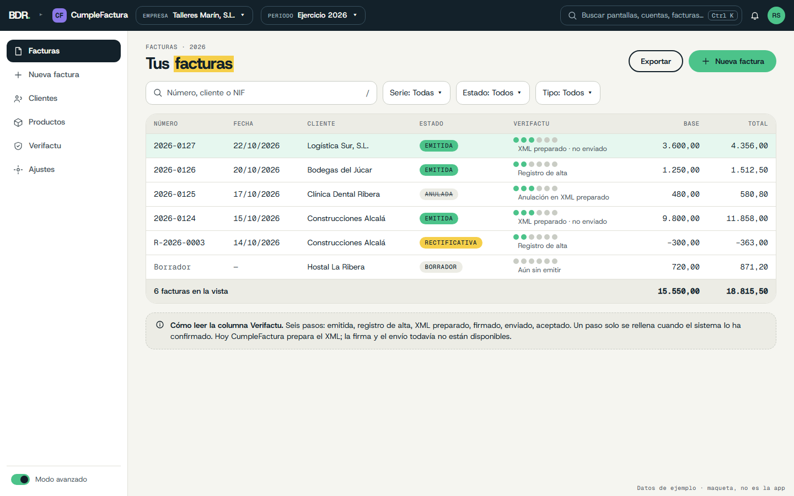
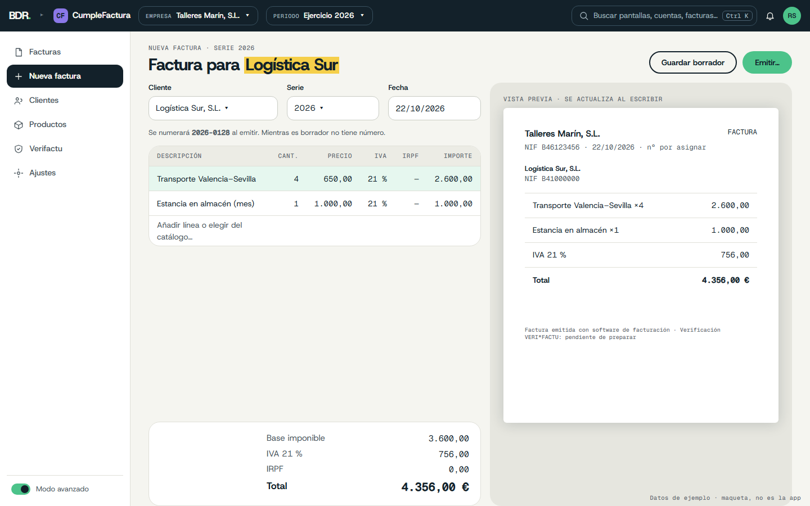
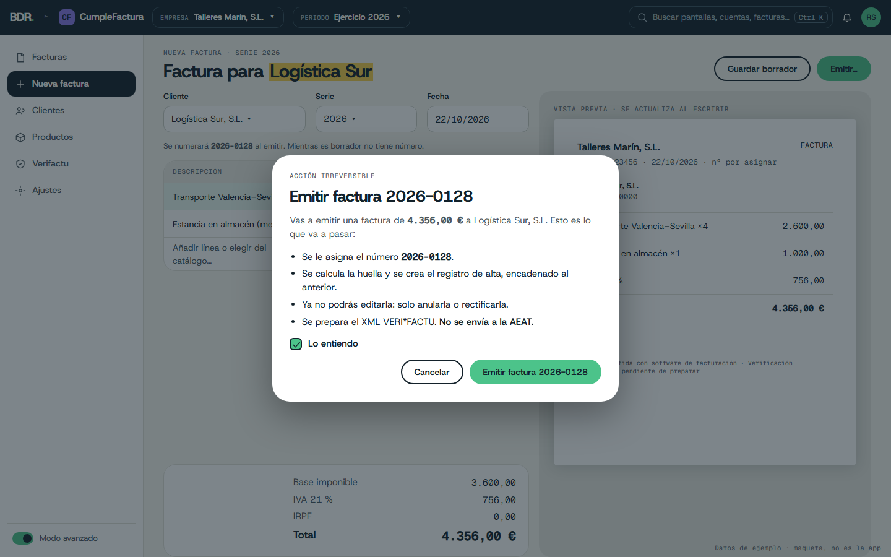
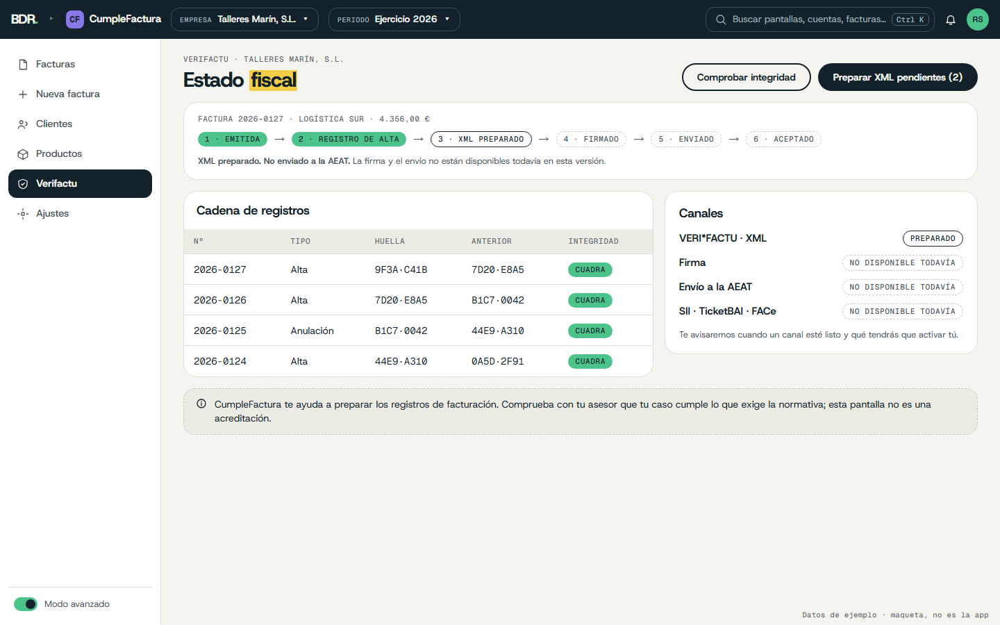
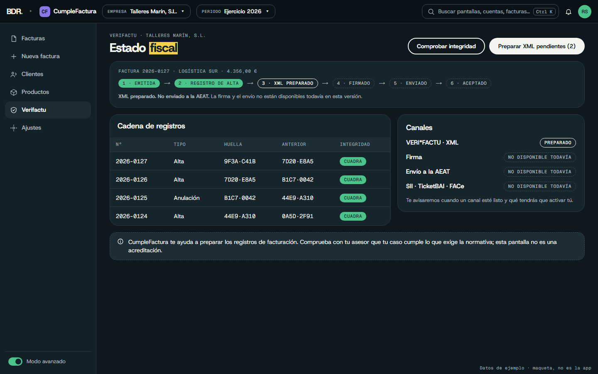

# UX/UI — CumpleFactura (rediseño)

Propuesta v1 · octubre 2026 · sigue la Guía de marca BDR v1.0 y es coherente con Empéñate, DocGen y Alquílame.
Maquetas: `docs/mockups/` (HTML + PNG a 1440×900).

## Idea guía

> Emites una factura y ves, sin dudar, en qué punto está su camino hacia Verifactu.

Usuarios: autónomos y pymes que facturan a diario y quieren cumplir sin estudiar normativa. Escritorio (Tauri 2, local-first); la versión web prevista (Vercel + Supabase) usa las mismas pantallas.

## Principios

1. **Estado fiscal honesto.** Cada factura muestra seis pasos: Emitida → Registro de alta → XML preparado → Firmado → Enviado → Aceptado. Un paso solo se rellena si el sistema lo ha confirmado. Hoy la app prepara el XML; firma y envío se muestran como «No disponible todavía».
2. **Numeración solo al emitir.** El borrador dice «Se numerará 2026-0128 al emitir»; el número real lo asigna Rust (como hoy).
3. **Lo irreversible se explica.** Emitir abre una confirmación con lo que ocurre, y «Lo entiendo».
4. **Pantalla partida.** Formulario a la izquierda, vista previa del PDF a la derecha.
5. **Teclado primero.** Líneas editables por teclado, `/` filtra, `Ctrl K` busca.
6. **Proponer, no decidir.** En rectificativas la app propone causa R1–R5 y método, y lo dice: «La causa jurídica la decides tú».
7. **Un fichero, un archivo mantenible.** `App.tsx` (~2.300 líneas) pasa a pantallas y componentes.

## Marca aplicada

| Elemento | Uso |
|---|---|
| **Violeta** | Color de producto: icono «CF» en la barra superior, tarjeta en la web y selector de apps. No en botones ni estados |
| Pizarra | Barra superior, ítem activo, botón oscuro |
| Papel | Fondo; zona de vista previa en `#E6E6DF` (mismo gris cálido que DocGen) |
| Menta | «Nueva factura», «Emitir», Emitida |
| Sol | Palabra clave del título (una por pantalla), rectificativa |
| Cielo / Coral | Pendiente / error o vencido (pequeño) |
| Geist Mono | Números de factura, NIF, importes, huellas, fechas |

Hoy: verdes `#1d5f4a`, Inter, solo modo claro → Menta + Pizarra, Host Grotesk + Geist Mono, claro y oscuro (sigue al sistema, interruptor en Ajustes). Tokens en `docs/mockups/_assets/app.css`.

## Arquitectura de información

Barra lateral: **Facturas · Nueva factura · Clientes · Productos · Verifactu · Ajustes**. Barra superior común de la suite (empresa y periodo siempre visibles).
- Primer arranque: asistente de 4 pasos (empresa, fiscalidad, primera serie, carpeta de exportación).
- Ventana mínima 1024×700; el menú se pliega por debajo de 1200 px; diálogos nativos para abrir/guardar.
- En la web, mismo shell; en Tauri el login es opcional mientras sea local-first.

## Pantallas clave

### 1. Facturas

Buscador (`/`), filtros (serie, estado, tipo), tabla con **estado de negocio** y **línea de pasos Verifactu** (seis puntos + texto), totales al pie. Aviso fijo que explica cómo leer la columna.

### 2. Editor de factura

Cliente, serie, fecha; líneas con cantidad, precio, IVA, IRPF; totales fijos en mono; vista previa del PDF actualizándose. Catálogo con autocompletado.

### 3. Confirmación de emisión

«Emitir factura 2026-0128»: se asigna número, se crea el registro de alta encadenado, ya no se podrá editar, **se prepara el XML pero no se envía a la AEAT**. Casilla «Lo entiendo»; el botón repite el verbo.

### 4. Verifactu
 
Estado por factura, cadena de registros (huella corta en mono, integridad), canales: XML preparado / firma / envío / SII · TicketBAI · FACe → «No disponible todavía». Texto prudente: la pantalla ayuda a preparar los registros; no acredita cumplimiento.

### 5. Rectificativa (sin maqueta)
Asistente: qué ha pasado → propuesta de causa R1–R5 y método (sustitución o diferencias) como **sugerencia** → vista previa → confirmación.

## Microcopy

| Situación | Sí | No |
|---|---|---|
| Vacío | «Aún no hay facturas. Crea la primera.» | «¡Esto está muy vacío!» |
| Emitir | «Emitir factura 2026-0128. Después no se podrá editar; solo rectificar.» | «¿Seguro?» |
| Estado parcial | «XML preparado. No enviado a la AEAT.» | «Listo.» |
| Canal ausente | «No disponible todavía.» + motivo | «Próximamente 🚀» |
| Límite | «Comprueba con tu asesor que tu caso cumple lo que exige la normativa.» | «Cumple la ley al 100 %.» |

Tuteo; sin humor en importes, plazos ni avisos. Nunca «homologado» ni «la ley ya está cubierta»; no usar «Aceptado» si no hay respuesta confirmada de la AEAT.

## Accesibilidad

WCAG 2.2 AA claro y oscuro; los pasos Verifactu llevan texto además de punto de color; foco 2 px; zona táctil ≥ 44 px; `Esc` cierra diálogos; formato `es-ES`.

## Decisiones (propuestas, 2026-10-25)

- Marca BDR con Violeta como color de producto; modo oscuro según el sistema.
- Estado fiscal en seis pasos, siempre visible; canales sin implementar → «No disponible todavía».
- Densidad cómoda (48 px) por defecto.
- Partir `App.tsx` en `features/` (invoices, customers, products, fiscal, settings), alineado con `PRODUCT_BRIEF_CUMPLEFACTURA.md`.
- Las facturas emitidas entran en ContaPro con su chip fiscal de origen.
- Login: Cuenta BDR común, opcional en Tauri.

## Por definir

1. ¿Cuándo se activan firma y envío? Determina qué pasos de la línea son «No disponible todavía» en el lanzamiento.
2. ¿Se muestra «Enviado/Aceptado» solo en entorno de pruebas (la app ya tiene preflight del sidecar)? Propuesta: sí, con etiqueta «Pruebas».
3. ¿SII, TicketBAI y FACe: se muestran como canales futuros o se ocultan hasta que existan?
4. ¿Paquete de componentes compartido con ContaPro y AEAT 200 (stacks distintos: Vite/Tauri vs Next.js)?
5. ¿Versión web: mismas pantallas con Supabase, o recorte de funciones?
6. ¿Se mantiene un primer arranque de 4 pasos o se parte de datos importados de ContaPro?
